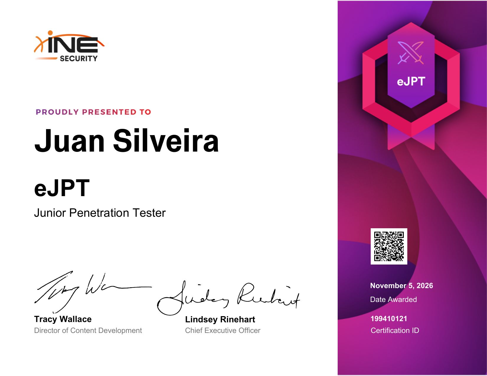

<div align="center">

# 🛡️ eJPTv2 — Notes & Methodology

**Junior Penetration Tester · INE Security**

[](https://certs.ine.com/d2b13082-243d-4e5b-892a-691ae397534f)


<a href="https://certs.ine.com/d2b13082-243d-4e5b-892a-691ae397534f"></a>

**Certification ID:** `199410121` · [Verificar certificado](https://certs.ine.com/d2b13082-243d-4e5b-892a-691ae397534f)

*Mi camino de preparación para el eJPTv2: qué estudié, cómo me organicé y qué aprendí.*

</div>

> ⚠️ **Disclaimer:** Este repo **no contiene preguntas, respuestas, flags ni información del entorno del examen**, respetando el NDA de INE. Es material de estudio propio, pensado para entornos autorizados (labs y CTFs).

---

## 📑 Índice

- [Sobre la certificación](#-sobre-la-certificación)
- [Mi preparación](#-mi-preparación)
- [Estructura del repo](#-estructura-del-repo)
- [Labs que me ayudaron](#-labs-que-me-ayudaron)
- [Recursos](#-recursos)
- [Lecciones aprendidas](#-lecciones-aprendidas)

---

## 📝 Sobre la certificación

| | |
|---|---|
| **Emisor** | INE Security |
| **Nivel** | Entry-level, 100% práctico |
| **Dominios** | Assessment Methodologies · Host & Network Auditing · Host & Network Pentesting · Web App Pentesting |
| **Resultado** | ✅ Aprobado — Noviembre 2026 |

---

## 📚 Mi preparación

| Etapa | Qué hice | Tiempo |
|---|---|---|
| Base | Linux y redes (Diplomatura UTN) | _completar_ |
| Curso | Penetration Testing Student (INE) | _completar_ |
| Práctica | Máquinas de HTB y rooms de TryHackMe | _completar_ |
| Repaso | Mis cheatsheets en [juanicerouno.com/cheatsheets](https://juanicerouno.com/cheatsheets/) | _completar_ |

---

## 📂 Estructura del repo

```
eJPTv2-Notes/
├── README.md
├── 01-metodologia/        → mi flujo de trabajo paso a paso
├── 02-enumeracion/        → apuntes por servicio
├── 03-web/                → apuntes de web app pentesting
├── 04-post-explotacion/   → apuntes de post-explotación
├── 05-pivoting/           → apuntes de pivoting
└── recursos.md            → links, videos y labs
```

---

## 🧪 Labs que me ayudaron

| Plataforma | Máquina / Room | Qué practiqué |
|---|---|---|
| Hack The Box | Blue | _completar_ |
| Hack The Box | Lame | _completar_ |
| Hack The Box | Devel | _completar_ |
| Hack The Box | Jerry | _completar_ |
| TryHackMe | Vulnversity | _completar_ |

---

## 🔗 Recursos

- [INE — eJPTv2](https://security.ine.com/certifications/ejpt-certification/)
- [Hack The Box](https://www.hackthebox.com)
- [TryHackMe](https://tryhackme.com)
- [PortSwigger Web Security Academy](https://portswigger.net/web-security)

---

## 💡 Lecciones aprendidas

1. _completar_
2. _completar_
3. _completar_

---

<div align="center">

**Siempre Soñando Alto.** 🚀 · [LinkedIn](https://linkedin.com/in/juanizxcvbn) · [GitHub](https://github.com/Juanizxcvbn)

</div>
